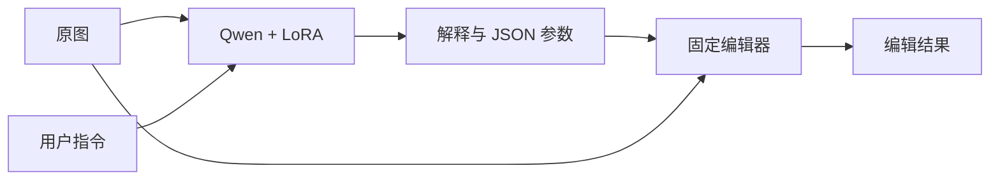

# IEA 原理与复用指南

> 后续已完成[第七轮编辑器CPU诊断](experiments/functional-v7-20261105/REPORT.md)：固定第六轮预测，仅替换平滑曲线，能减少部分截断，却未解决夜景噪声、提亮不足和力度错误；未启动新训练、未改默认工具。第六轮两条末轮已完成实际网页试用与离线一致性核验，累计GPU占用9.3317/16小时（UTC08:19快照，之后继续计费）。

> [第五轮连续参数头](experiments/functional-v5-20261105/REPORT.md)未通过原始请求初筛：最好4/6但仍有严重反向编辑，未升级或开封验收。[第六轮](experiments/functional-v6-20261105/REPORT.md)已完成：160原图组（人像／风景各80）、460语义案例、920条不同中英文记录，其中100例保留原始英文请求。新原始请求开发最好15/20（默认12/20），仍有3例严重副作用，旧回归3/6，未过门槛；未升级、未开封验收。两条末轮模型已登记为诊断试用，不能称为高实用性模型。

> 第三轮纠错已完成：37条偏好＋56条监督保持记录、38张照片（人像／风景各19）。偏好优化最好81/100，匹配SFT80/100；均保留1例开发严重过曝，原始请求均3/6。未升级默认模型，验收仍关闭。[第三轮报告](experiments/functional-v3-20261104/REPORT.md)。[第四轮](experiments/functional-v4-20261105/REPORT.md)同样未过门槛：观测输入最好80/100、原始请求3/6，仍有严重过曝。两条第1轮已接入诊断试用，未升级、未开封验收。


> 第二轮最新状态：训练、9个模型的开发逐图复核和试用接入均已完成，实用目标尚未达成。新课程e3为81/100双语完整合格，但新增2例严重过曝；父模型32/100、匹配旧数据对照e2为34/100。仅4/20原图的五项任务全合格，原始请求补充检查3/6且仍有过曝。未升级默认模型、未换种子复核，验收保持关闭。[完整结果、数据与模型位置](experiments/functional-v2-20261104/REPORT.md)。


## 第二轮数据与重放入口（开发完成）

第二轮是独立模块 `scripts/functional_v2/`，数据为 `data/training/functional-v2-20261104/`，实验为 `experiments/functional-v2-20261104/`。`source-splits.json` 记录 100 张入选照片来源；`train-cases.json` 保留最初候选，`train-final-cases.json` 为经视觉核验与修订后的 360 个案例，`train-accepted.json` 为实际 720 条训练记录；`control-accepted.json` 是旧数据继续训练对照。`train-rejected` 等备份若存在均不入训。开发与验收使用 `*-final-cases.json`，原草稿保留。

服务器在项目根执行 `PYTHONPATH=scripts envs/iea-rl/bin/python -m functional_v2.train --route curriculum --gpu 0`，另须设置 `CUDA_VISIBLE_DEVICES=0`；对照将 route 改为 control、gpu 和环境变量改为 2。脚本拒绝覆盖已有运行目录，并核对数据与父权重。请先查看已有运行状态，避免重复训练。两条路线从同一第一轮默认 adapter 继续训练，加载原始底座加这一份 adapter；不能再叠加历史父 adapter。

训练、推理继续调用冻结 `functional_v1.runtime`，使用相同提示与编辑器。`functional_v2.common.GPUJob` 直接复用第一轮 16 GPU 小时账本，不另开预算；GPU 1 原作者服务继续保留。第二轮已固定新课程第3轮、旧数据对照第2轮并接入现有试用页；模型身份分别登记为 functional-v2-curriculum-20261106 和 functional-v2-control-20261106。默认仍为第一轮候选，第二轮验收未开封。

整理：2026-11-03（Asia/Shanghai）。实验完成：2026-11-02。[项目总览](README.md) · [实验记录与结论](实验记录与结论.md)

本文集中说明概念、数学、环境与复用。实际效果和实验数字统一见结果文档。

## 功能优先实验与试用入口

本轮代码单独放在 `scripts/functional_v1/`，没有改写历史编辑器、冻结预测或旧训练脚本。数据入口为 `data/training/functional-v1-20261104/`，实验入口为 `experiments/functional-v1-20261104/`。编辑、离线评测和网页推理共用 `runtime.py` 与版本化编辑器。中英文请求直接输入本地模型，不经过外部 API 改写或翻译。

新编辑器修正对比度为 `2^(value/100)`；阴影使用保留黑白端点的曲线，高光通过亮度权重调整亮处，允许负值压低白色峰值；新增强度 0–100 的 `sepia` 工具表达棕褐色风格。明确要求不编辑时直接保留原像素。改写指令的监督目标是经逐图核验的本版本工具结果，不自动使用原 GIER 参考图。

服务器使用原有两个环境：`envs/iea-rl` 运行模型和训练；`envs/iea` 运行 Flask 页面。原 IEA 页面 `12345` 与原服务 `18181` 保持独立。新页面绑定 `127.0.0.1:12346`，模型工作进程绑定 `127.0.0.1:18282`，通过本机 SSH 转发访问：

```bash
ssh -N -L 12346:127.0.0.1:12346 SJTU1
```

浏览器打开 `http://127.0.0.1:12346`。页面提供修图试用、训练候选及实验记录；尚未训练的模型不会冒充可用候选。模型在有请求时加载，空闲约两分钟释放 GPU。试用输入和反馈只保存在实验的 `demo/` 下，不自动加入训练集。

本轮训练前必须存在通过核验的 `train-accepted.json` 与 `label-acceptance.json`；缺少逐例 Codex 直接视觉记录或目标不能由参数准确重放时，不予准入。冻结 7B Qwen 的视觉判断未通过方向事实校准，现仅作参考，不参与准入和检查点选择。所有通过结论均为 Codex 直接 AI 评审，没有人工认证。训练完成、AI 功能评审和用户试用反馈分别记录。

服务器服务启动命令如下，已运行时无需重复启动：

```bash
cd /mnt/sdc/zhc/IEA
CUDA_VISIBLE_DEVICES=2 PYTHONPATH=scripts envs/iea-rl/bin/python -m functional_v1.worker --gpu 2 --port 18282
# 另一个终端
PYTHONPATH=scripts envs/iea/bin/python -m functional_v1.web --port 12346
```

离线推理与网页均调用 `functional_v1.runtime.predict`、严格单 JSON 解析器与 `functional-editor-v1.2-sepia`。网页上传保留原始分辨率，模型视觉输入限 262144 像素；返回的参数作用在原分辨率像素。保持原样请求直接返回同样 RGB 像素，已用中英文实际验证。非法参数或推理失败返回错误状态，界面不显示编辑成功。单轮接口是 multipart `POST /api/edit`，字段 `image`／`instruction`／`model_id`；反馈接口 `POST /api/feedback` 接收 `request_id`／`verdict`／`comment`。

当前默认模型是 `models/from-sft-calibrated/sft-functional/seed-01`，基础候选在 `models/from-base/sft-functional/seed-01`；两者及复核模型均已下载本地、按哈希核验。原始 Qwen 底座在服务器，不能只用 adapter 单独推理。选定检查点、逐图结果、已知力度和复合要求失败见[功能实验报告](experiments/functional-v1-20261104/REPORT.md)。试用框架完成不等于高实用性目标完成。

## 目录

- [1. 系统到底在学习什么](#1-系统到底在学习什么)
- [2. SFT 的目标与局限](#2-sft-的目标与局限)
- [3. LoRA 与 QLoRA](#3-lora-与-qlora)
- [4. 一次更新与训练预算](#4-一次更新与训练预算)
- [5. GRPO 怎样使用图片反馈](#5-grpo-怎样使用图片反馈)
- [6. 评测与图像检查口径](#6-评测与图像检查口径)
- [7. 环境与目录](#7-环境与目录)
- [8. 模型加载与历史复核](#8-模型加载与历史复核)

## 1. 系统到底在学习什么

IEA 是一个工具调用式修图系统：视觉语言模型读取原图和用户指令，生成工具参数，再由固定编辑器修改像素。



用公式表示：

$$
\hat p = \operatorname{parse}(M_{\theta_0,\phi}(I,u)),\qquad \hat J=E(I,\hat p).
$$

$I$ 为原图，$u$ 为指令，$\theta_0$ 为冻结基础权重，$\phi$ 为可训练 LoRA，$E$ 为固定编辑器。训练时有标签参数 $p^*$ 和参考图 $J$；模型生成时不读取它们。

| 容易混淆的概念 | 实际含义 |
|---|---|
| 基础模型参数 | Qwen 的神经网络权重 |
| LoRA 参数 | 训练得到的小矩阵增量，改变模型生成行为 |
| 修图参数 | JSON 中 brightness、contrast 等数值 |
| adapter | LoRA 增量权重，需要依附基础模型 |
| checkpoint | 某一步保存的模型及可能包含的优化器、调度器、随机状态 |
| 样本数 | 指令记录数量；同一原图可有多条指令 |
| 原图组数 | 去重与划分使用的独立来源单位 |

本轮 Image-Edit 输入一张原图；Image-Summary 原本需要前后图以逆向总结意图，但没有参与本轮训练。编辑器支持 16 种全局工具，实际训练标签覆盖其中 8 种；支持某工具不代表模型已经学会它。

Qwen 将图像转换为视觉 token，与系统和用户文本共同参与语言解码。视觉输入上限影响视觉 token 和计算量，`cutoff_len` 限制完整序列长度，二者不是同一个开关。

Attention 的基本计算为：

$$
Q=XW_Q,\quad K=XW_K,\quad V=XW_V,\qquad
\operatorname{Attention}(Q,K,V)=\operatorname{softmax}\!\left(\frac{QK^\top}{\sqrt{d_k}}+\text{mask}\right)V.
$$

本轮仅为语言层的 `q_proj` 和 `v_proj` 加 LoRA；视觉编码器与基础投影权重冻结。

## 2. SFT 的目标与局限

对目标回答 token 序列 $y$，自回归概率为：

$$
p(y\mid I,u)=\prod_{t=1}^{T}p(y_t\mid I,u,y_{<t}).
$$

训练使用真实目标前缀（teacher forcing），推理使用模型自己生成的前缀。训练 loss 下降不保证自由生成完全正确。

监督位置用掩码 $m_{it}$ 表示，SFT 目标为：

$$
\mathcal L_{\mathrm{SFT}}
=-\frac{\sum_i\sum_t m_{it}\log p_{\theta_0,\phi}(y_{it}\mid I_i,u_i,y_{i,<t})}{\sum_i\sum_t m_{it}}.
$$

提示、图像位置和 padding 不直接贡献目标 loss；代码里 `labels=-100` 是忽略标记。它们仍参与上下文计算。跨 micro-batch 的实际归一化由冻结 Trainer 实现决定。

当前监督包含解释文本、JSON 和模板终止信息。JSON 数字也被当作文本 token，没有额外的参数回归损失，也未直接反向传播图片距离：

$$
\|\hat p-p^*\|^2,\qquad D(E(I,\hat p),J).
$$

上式是其他可能目标，不是本轮已执行的 SFT 配方。预测正确 token 的概率从 0.2 提高到 0.8，会让单 token loss 从 1.609 降到 0.223，但不能据此推断图片质量。

因此需要分别检查文本 loss、工具可执行率、参数方向与幅度、执行后图片指标。仅 JSON 监督也不自动等于仅 JSON 输出：若保留解释前缀但将其 loss mask 掉，仍需明确其训练与推理处理。

## 3. LoRA 与 QLoRA

冻结线性层权重 $W_0$，LoRA 用低秩增量：

$$
W=W_0+\frac{\alpha}{r}BA,\qquad
h=W_0x+\frac{\alpha}{r}B(Ax).
$$

$A\in\mathbb R^{r\times d_{in}}$，$B\in\mathbb R^{d_{out}\times r}$，只训练 $A,B$。本轮 $r=8,\alpha=16$，缩放系数为 2。

一个手算例子：$W_0$ 为四维单位矩阵，$r=1,\alpha=2$，令 $A=[1,0,-1,0]$，$B=[0.1,0.2,0,-0.1]^\top$，$x=[2,1,0,3]^\top$。则 $Ax=2$，增量为 $[0.4,0.8,0,-0.4]^\top$，输出为 $[2.4,1.8,0,2.6]^\top$。

单个适配层需要 $r(d_{in}+d_{out})$ 个参数。本轮语言模型有 28 层：

| 模块 | 输入维度 | 输出维度 | rank 8 参数量 |
|---|---:|---:|---:|
| q_proj | 3,584 | 3,584 | 57,344 |
| v_proj | 3,584 | 512 | 32,768 |

因此总可训练参数为：

$$
28(57,344+32,768)=2,523,136,
$$

保存的 LoRA 张量为 $28\times2\times2=112$ 个。rank 与目标模块是本轮配方，没有通过容量消融证明最优。标准 LoRA 初始化使增量初始为零，当前未采用 DoRA、PiSSA 或 rsLoRA。

QLoRA 将基础权重量化保存，LoRA 仍可训练。本轮采用 NF4、双重量化和 BF16 计算：

- NF4 是基础权重的 4-bit 量化表示；不是全部计算都用 4 bit。
- 双重量化进一步压缩量化尺度等元信息。
- BF16 用于计算；部分层、梯度和优化器状态可能使用更高精度。
- 训练显存还包括激活、梯度、优化器、图像 token、缓存与临时工作区。
- PyTorch 已分配、预留和整卡采样占用是不同口径；采样可能遗漏瞬时峰值。

理论来源：[LoRA](https://arxiv.org/abs/2106.09685)、[QLoRA](https://arxiv.org/abs/2305.14314)。

## 4. 一次更新与训练预算

一次优化器更新依次包含：取数据与图像预处理 → 前向 → masked loss → 反向 → 梯度累积 → 裁剪与 AdamW 更新 → scheduler 更新。梯度检查点通过重算部分前向节省激活显存；SDPA 是 Attention 实现路径。

Stage 1 micro-batch 为 2，累积 8，常规有效 batch 为 16。每轮 3,000 条：1,500 个 micro-batch，包含 187 个完整累积组及最后 4 个 micro-batch，因此每轮 188 次更新、两轮 376 次；尾批实际曝光为 8 条，总曝光为 6,000，不能用 `376×16=6,016` 替代。

本轮使用显式步数，避免当前版本按 epoch 估算时向下取整。前 5% warmup 后用 cosine 降低学习率。种子、样本曝光、监督 token 和 GPU 时间分别报告；相同步数不代表相同学习信号或计算量。

正式采用的高分辨率短跑为 262,144 像素、batch 2×8；实际处理 192 条、12 次优化器更新，去掉前两步后的吞吐约 1.84 条/秒。最长 16 条记录的压力检查无 OOM；全部 3,400 条冻结记录未发生提示或目标截断，训练最长序列 755 token。这些检查验证工程可行性，不证明参数或图像效果最优。

## 5. GRPO 怎样使用图片反馈

对同一个输入采样 $G=4$ 个回答，解析参数并执行编辑，再由参考图评分。本轮有效输出奖励为：

$$
r=\operatorname{clip}\!\left(\frac{d_0-d}{\max(d_0,0.01)},-1,1\right),
\quad d_0=D(I,J),\ d=D(E(I,\hat p),J).
$$

非法输出或编辑失败为 −2；数据读取和指标异常作为运行错误，不混入策略惩罚。参考图不进入生成提示，JSON 解析和编辑器无需可导。

组内相对优势为：

$$
A_i=\frac{r_i-\bar r}{s_r+10^{-4}}.
$$

用采样策略与当前策略的 token 概率比 $\rho_{it}$，目标包含：

$$
\mathbb E\!\left[\min\big(\rho_{it}A_i,\operatorname{clip}(\rho_{it},1-\epsilon,1+\epsilon)A_i\big)
-\beta D_{KL}(\pi_\theta\|\pi_{ref})\right].
$$

本轮 $\epsilon=0.2,\beta=0.01$，参考策略是冻结 A，包含它的 adapter；关闭 adapter 后得到的原始 Qwen 不是该参考策略。实际 token/序列归一化见冻结 TRL 实现。

例：奖励 −0.8、−0.6、−0.4、−0.2 的四个候选中，−0.2 可有正优势，但仍差于奖励为 0 的原图。奖励有差异不代表已有绝对质量收益；整段回答共享图片反馈也不等于已精确定位错误数字。

本轮 `scale_rewards='group'`、`loss_type='grpo'`、每组一次更新；未裁剪的全有效组中，按提示进行的正线性奖励缩放会被组内标准化大体抵消。不能仅因奖励除以 $d_0$ 就断言它是失败主因。

论文采用多任务和额外工具有用性奖励；本轮只使用上述 L1 改善奖励。[GRPO 原文](https://arxiv.org/abs/2402.03300)、[IEA 原文](https://arxiv.org/abs/2606.08016)。

## 6. 评测与图像检查口径

图片主指标为全样本归一化像素 L1，另报 RMSE：

$$
L1=\frac1N\sum_j|x_j-y_j|,\qquad RMSE=\sqrt{\frac1N\sum_j(x_j-y_j)^2}.
$$

本轮对解码像素评分，不进行 ICC 色彩管理；图片尺寸不一致时按冻结协议插值。像素相似度不等价于人类审美或指令满意度。

复核时遵循以下口径：

1. 模型锁定后做确定性生成：不采样，最多 512 个新 token，repetition penalty 为 1.0。
2. 解析首个 fenced JSON；只接受冻结的 16 个工具、数值范围 [-100,100] 及固定别名；拒绝未知工具、重复键、嵌套、布尔值、非有限值和越界值。不事后修复或重试。
3. 无效输出保留原文本和错误，按原图回退计分；有效子集指标必须同时报告覆盖率。读取失败阻止验收。
4. 空参数或全零参数仍通过编辑器，可能因颜色空间往返改变像素；真正 NoEdit 是独立原图基线。grain 按样本 ID 固定随机种子。
5. 统计以原图组为独立单位。配对 bootstrap 区间反映样本不确定性，不包含训练种子间波动；子组与多重比较的探索性须标明。
6. 预选案例在看结果前固定；先记录匿名面板观察，再解码；不因知道模型身份改写原始观察。

视觉记录用语：方向为 `aligned / partly_aligned / opposite / no_visible_change / ambiguous`；幅度为 `reasonable / too_weak / too_strong / unclear`；无关变化为 `none_obvious / possible / clear / unclear`。模糊“优化”请求不强行判定唯一方向，需给出具体可见依据。

图片完整展示，保留宽高比，不改色或裁去失败。图表保留源数据、PDF/SVG/PNG、来源哈希，做对齐、字号与碰撞审计并直接查看。Stage 1 定量图为 300 dpi；Stage 2 定量图为 600 dpi、案例为 300 dpi。AI 辅助检查不得描述为人工用户研究或完整质量认证。

## 7. 环境与目录

实际训练环境为 uv 创建的 Python venv，依赖通过 uv pip 安装。Stage 1、Stage 2 和绘图环境分开维护。

| 环境 | 路径 | 主要版本 |
|---|---|---|
| Stage 1 训练 / 推理 | `/mnt/sdc/zhc/IEA/envs/iea` | Python 3.11.18；Torch 2.6.0+cu124；Transformers 4.51.3；PEFT 0.15.2；LLaMA-Factory 0.9.4.dev0 |
| Stage 2 | `/mnt/sdc/zhc/IEA/envs/iea-rl` | Torch 2.6.0+cu124；Transformers 4.56.2；TRL 0.23.1；PEFT 0.17.1；NumPy 1.26.4 |
| CPU 图表与报告 | `/mnt/sdc/zhc/IEA/envs/report` | 与训练依赖隔离 |

服务器驱动为 550.135，CUDA runtime 为 12.4，GPU 为 RTX 4090。版本为既有实验记录，不代表实时资源状态。模型、下载和缓存放在 `/mnt/sdc`。Mac 是资料与验收入口，不承担 GPU 训练。

| SJTU1 相对路径 | 用途 |
|---|---|
| `repo/` | 官方源码；commit `7e9571fca3b4f22dffbf7f46ba4deaf72fd75956` |
| `repo/src/` | 提示模板、编辑器和原始评测实现 |
| `repo/chat_interface/` | 网页 Demo |
| `repo/LLaMA-Factory/`、`repo/verl/` | 作者 SFT / RL 框架；本轮 RL 入口在项目 scripts 中 |
| `repo/datasets/` | 原始标注和图片 |
| `data/stage1/ready/` | 路径规范化、隔离重复后的可用数据池 |
| `data/stage1/splits/image-edit-3k-v1/` | Stage 1 冻结训练 / 验证 / 测试 |
| `data/stage2/stage2-A-edit-grpo-v1/` | Stage 2 冻结数据 |
| `models/Qwen2.5-VL-7B-Instruct/` | 固定原始基础权重 |
| `outputs/`、`logs/` | 完整模型产物、检查点、预测与运行日志 |
| `archives/` | 已完成验收归档 |

Stage 2 用 GPU 2 训练，GPU 0 评测及 SFT；GPU 1 的既有 Demo 保留。激活脚本默认可能指向 GPU 1，使用前须确认空闲卡并显式指定 GPU，不根据旧 PID 判断当前任务状态。

## 8. 模型加载与历史复核

### 模型位置

| 模型 | 服务器 adapter，均相对 `/mnt/sdc/zhc/IEA/` | 本地副本 |
|---|---|---|
| A | `outputs/stage1-A-image-edit-3k-v1` | [A](artifacts/adapters/A) |
| B | `outputs/stage1-B-image-edit-3k-v1` | [B](artifacts/adapters/B) |
| SFT | `outputs/stage2-A-edit-grpo-v1/sft-control/final` | [SFT](artifacts/stage2-acceptance-v1/models/SFT) |
| GRPO | `outputs/stage2-A-edit-grpo-v1/formal-v1/selected` | [GRPO](artifacts/stage2-acceptance-v1/models/GRPO) |

基础权重使用上述固定 revision，不能将 adapter 单独作为完整模型加载。模型哈希、环境和冻结协议见 [Stage 1 模型锁](configs/evaluation-models-v1.json)、[Stage 2 最终收据](artifacts/stage2-acceptance-v1/final-acceptance.json)。

### 查看与校验

这些命令只供需要时使用，本次文档整理没有连接服务器或启动作业。

```bash
ssh SJTU1
cat /mnt/sdc/zhc/IEA/logs/stage1-A-3k/status.json
```

本地核验 Stage 2 归档，不加载模型或访问 GPU，报告另写到临时目录：

```bash
python3 scripts/archive_stage2.py verify \
  --archive artifacts/stage2-acceptance-v1/iea-stage2-acceptance-v1.tar.gz \
  --report /tmp/iea-stage2-recheck.json
```

加载 Stage 1 A 的已验证示例：先在 SJTU1 确认目标 GPU 空闲，显式设置 `IEA_GPU` 后激活原环境。以下只读取训练样本，不作优化器更新。

```bash
export IEA_GPU=2
source /mnt/sdc/zhc/IEA/activate.sh
```

```python
import json
from pathlib import Path
from llamafactory.chat import ChatModel

root = Path('/mnt/sdc/zhc/IEA')
p = json.loads((root / 'configs/evaluation-protocol-v1.json').read_text())
args = {**p['model_common'], **p['models']['A'], **p['generation']}
args.pop('num_return_sequences', None)
chat = ChatModel(args)
row = json.loads((Path(p['split_directory']) / 'train.json').read_text())[0]
system = next(m['content'] for m in row['conversations'] if m['role'] == 'system')
messages = [dict(role=m['role'], content=m['content'])
            for m in row['conversations'] if m['role'] == 'user']
answer = chat.chat(messages, system=system, images=row['images'], **p['generation'])[0]
print(answer.response_text)
```

B 可替换模型配置键；Stage 2 复用 [stage2_runtime.py](scripts/stage2_runtime.py) 与对应冻结环境，不能默认跨环境数值一致。正式评测应使用 [Stage 1 协议](configs/evaluation-protocol-v1.json) 和 [Stage 2 评测入口](scripts/evaluate_stage2.py)，在新运行目录中固定输入、模型、配置与代码身份。

### 归档范围和旧文档

Stage 1 包不含完整基础权重、原始图片全集、30 例之外的全部编辑 PNG 或 optimizer 大文件；完整产物保留在服务器。Stage 2 包含四个正式检查点的 optimizer/scheduler/RNG、预测图片、候选和奖励，但也不重复打包基础权重与原始图片全集。凭据和原始激活脚本不进入交付。

既有归档、收据与冻结脚本描述的是实验完成时的文件身份，历史文档引用和哈希保持原样。本次三份文档是阅读版，不用它们替换历史哈希证据。

如确需重放含旧文档名的验收或打包流程，在独立工作目录恢复 [12 份原文备份](artifacts/document-history/markdown-before-consolidation-20261103.zip)，核对其中 `DOCUMENT-MANIFEST.json`，并与完整实验归档配套使用。不要在当前目录解压覆盖阅读版 README，也不要重新覆盖已存在的验收收据。

后续训练应另立实验身份与输出目录；实际续训需检查 optimizer、scheduler、RNG 和数据顺序。不能把“文件齐全”当成已验证恢复后轨迹等价，也不能沿用已查看测试集继续选模。


## 新一轮模型的推理与复核

最终选择 Seed20261104，位于本地 `artifacts/goal-v2-20261103/selected-adapter`；另外两个种子保留于同级 adapters。训练配置、提示格式、全部模型身份及选模时间见 `metadata/goal-v2-20261103/final-models-lock.json` 和 `development-training-lock-3k-v2.json`。恢复本轮归档时应使用单独目录，先核验清单；不要覆盖现有实验或旧归档。

复现环境为 Python 3.11.18、PyTorch 2.6.0+cu124、Transformers 4.56.2、TRL 0.23.1、PEFT 0.17.1，完整名称与版本见归档中的 `outputs/goal-v2-20261103/requirements-frozen.txt`，系统信息及基础权重核验亦在该目录。基础模型为 Qwen2.5-VL-7B-Instruct revision `cc594898137f460bfe9f0759e9844b3ce807cfb5`。基础权重外置；归档已包含用于本轮训练／验证／测试的图像与 JSON，但不是安装完毕的离线环境。

冻结程序使用绝对根 `/mnt/sdc/zhc/IEA`。在另一个环境重放时需在隔离挂载／容器中恢复这个根，或另建带新身份的移植版本；直接改冻结源码后不能继续声称文件哈希与历史结果相同。

交付推理保留历史精度路径：先 `load_model(adapter, trainable=True)` 完成 NF4 和 k-bit 准备，再 `peft_module_casting_to_bf16(model)`，随后冻结全部参数、`model.eval()`。直接换成 `trainable=False` 可能改变精度路径。输入仅原图与原始 system/user 请求；新模型追加冻结的 JSON 格式要求，参考图和标签只在生成后参与评分。

已运行并通过以下单例重放，输出到新目录；回复、解析参数、PNG SHA 和 L1 均与历史预测完全一致。命令要求空闲 GPU；不要覆盖原目录，重放可另取新目录名。

```bash
CUDA_VISIBLE_DEVICES=0 OMP_NUM_THREADS=4 TOKENIZERS_PARALLELISM=false envs/iea-rl/bin/python scripts/goal_v2_infer_delivered.py   --dataset data/goal-v2-20261103/test_sealed.json   --id GIER-Edit:test:000279 --model Seed20261104 --gpu 0   --output outputs/goal-v2-20261103/delivery-inference-replay-v1   --expected-prediction outputs/goal-v2-20261103/final-evaluation/Seed20261104/predictions.jsonl
```

重新训练须用新的 run 名，保持原始 A 起点，不接触留出数据：

```bash
CUDA_VISIBLE_DEVICES=0 OMP_NUM_THREADS=4 TOKENIZERS_PARALLELISM=false envs/iea-rl/bin/python scripts/goal_v2_train_json3k_long.py   --name reproduce-json3k-s20261104 --mode parameters --lr 1e-4   --gpu 0 --seed 20261104 --training-file train3k-contrast-calibrated.json

envs/iea-rl/bin/python scripts/goal_v2_average_adapter.py   --left outputs/goal-v2-20261103/reproduce-json3k-s20261104/checkpoint-512   --right outputs/goal-v2-20261103/reproduce-json3k-s20261104/checkpoint-1024   --output outputs/goal-v2-20261103/reproduce-json3k-s20261104/swa
```

将 seed 替换为另外两个预定值可重跑复核。训练保存 optimizer／scheduler／RNG；实际恢复烟测使用原始检查点，平均权重仅用于推理。烟测未证明原始下一批次或后续训练轨迹完全等价，跨硬件及依赖环境也不保证位级确定性。

已保存图像与统计可使用 `scripts/goal_v2_analyze_final.py` 复核；该程序保留原数值阶段的“视觉待检查”历史状态，最终交付状态应读取外置 `final-acceptance.json`。匿名观察原始文件冻结后未修改，解码另存；不能在已知身份后改写匿名评分。后续任何新配方都不得再用这 71 图做确认性选模。

最终交付已完成：35.13 GB 本地归档与 13,841 个成员的 SHA-256 全部通过，最终 13 项要求审计无待办。外置 `artifacts/goal-v2-20261103/final-acceptance.json` 是交付状态入口；`archive-verification.json` 记录完整本地核验，`completion-audit.json` 逐项列出目标证据和局限。归档内阅读文档为冻结打包时版本，外置收据与当前三份阅读文档记录随后完成的本地验收；冻结模型、数据、推理和指标身份保持不变。
